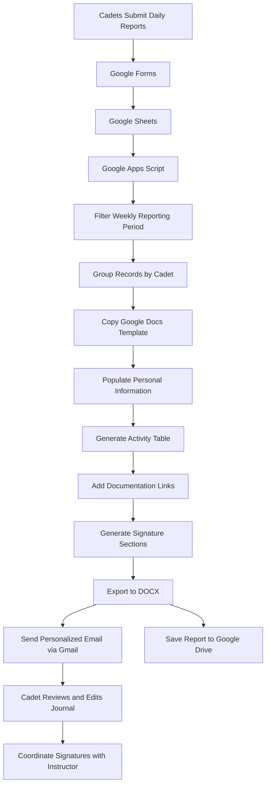
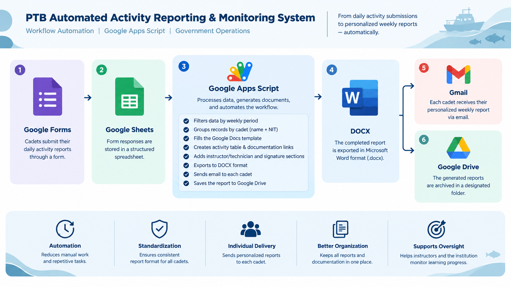

# PTB Automated Activity Reporting & Monitoring System

> **Automated Weekly Reporting System for the Pembelajaran Taruna Berprestasi (PTB) Program - Ministry of Marine Affairs and Fisheries of Indonesia**

## 1. Project Overview

The **PTB Automated Activity Reporting & Monitoring System** is a workflow automation solution developed during my internship at Indonesia's Ministry of Marine Affairs and Fisheries (*Kementerian Kelautan dan Perikanan - KKP*). The system was designed to streamline the administrative reporting process for the *Pembelajaran Taruna Berprestasi (PTB)* program, in which cadets document their daily learning activities and practical training experiences.

Previously, daily activity records needed to be compiled into structured weekly journals for reporting and approval. This process involved organizing individual submissions, preparing standardized documents, and distributing the reports to the respective cadets. To improve this workflow, I developed an automation script using **Google Apps Script** that processes daily activity submissions, generates personalized weekly journals in Microsoft Word format (`.docx`), and automatically distributes them to individual cadets via email.

The solution integrates Google Forms, Google Sheets, Google Docs, Google Drive, and Gmail into a single reporting workflow, reducing repetitive administrative work and establishing a more consistent reporting process.

### Project at a Glance

| Category | Description |
|---|---|
| Project Type | Business Process Automation |
| Industry | Government / Marine and Fisheries Education |
| Organization | Ministry of Marine Affairs and Fisheries of Indonesia (KKP) |
| Program | Pembelajaran Taruna Berprestasi (PTB) |
| Primary Users | Cadets, instructors, and technical supervisors |
| Primary Technology | Google Apps Script |
| Programming Language | JavaScript|
| Data Collection | Google Forms |
| Data Storage | Google Sheets |
| Document Generation | Google Docs and Microsoft Word (`.docx`) |
| Email Automation | Gmail |
| File Management | Google Drive |

## 2. Business Context

The PTB program requires cadets to record their daily learning activities, including practical training, learning topics, activity descriptions, supporting documentation, and instructor or technician information. These records serve as documentation of the cadet's learning progress and practical experiences.

For example, activities in the fish cultivation program may include:

- Feeding fish and monitoring cultivation environments.
- Handling and packing tilapia fingerlings.
- Collecting tilapia eggs and recording fertilization data.
- Monitoring embryonic development.
- Performing other practical activities under instructor or technician supervision.

Each daily submission must be compiled into a weekly journal containing the cadet's personal and educational information, activity records, documentation links, and signature areas for the relevant parties. The system transforms these individual daily submissions into structured weekly reports that can be reviewed, edited, and signed.

## 3. Business Problem

The reporting workflow presents several administrative challenges that can be addressed through automation.

**1. Repetitive Report Compilation**    
Daily activity submissions must be grouped by cadet and consolidated into a single weekly document. Performing these operations manually introduces repetitive work and increases the possibility of inconsistencies.    

**2. Inconsistent Document Preparation**    
Weekly journals must follow a standardized format, including personal information, educational program details, activity tables, documentation links, and signature sections. Manually preparing each document can create formatting inconsistencies and unnecessary administrative overhead.    

**3. Individual Report Distribution**    
Each cadet needs to receive their own weekly journal. Distributing reports individually requires matching the correct document to the correct recipient and maintaining an organized reporting process.    

**4. Documentation and Approval Workflow**    
Activity journals must contain links to supporting documentation and provide space for instructor or technician signatures and cadet approval. Missing documentation, incorrect records, or incomplete signature sections can require additional revisions.

### Business Objective

The objective was to **automate the repetitive stages of weekly activity reporting while maintaining a standardized document structure and an individual reporting workflow for each cadet.** The intended outcome was a more efficient, consistent, and organized administrative reporting process.

## 4. Solution Approach

I developed a Google Apps Script automation workflow that connects the existing data collection process with document generation, email distribution, and file storage.

The system performs the following operations:

1. Retrieves daily activity submissions from Google Sheets.
2. Determines the reporting period for the weekly journal.
3. Filters submissions to include records within the reporting period.
4. Groups activity records by cadet name and identification number (NIT).
5. Copies a predefined Google Docs journal template for each cadet.
6. Populates the template with personal information and activity records.
7. Generates a structured table containing the weekly activities and documentation links.
8. Creates signature sections for the instructors or technicians and the cadet.
9. Exports the completed document to `.docx` format.
10. Sends the document to the corresponding cadet through Gmail.
11. Saves a copy of the generated report in a designated Google Drive folder.
12. Moves the temporary Google Docs file to the trash after processing.

This approach preserves a standardized reporting format while minimizing the need for manual document preparation and distribution.

## 5. System Architecture

The system follows a straightforward data-to-document automation architecture.

### Component Responsibilities

| Component | Responsibility |
|---|---|
| Google Forms | Collects daily activity reports submitted by cadets. |
| Google Sheets | Stores form responses in a structured tabular format. |
| Google Apps Script | Executes the reporting logic, data filtering, grouping, document generation, and distribution workflow. |
| Google Docs | Provides the standardized journal template and serves as the temporary document-generation environment. |
| Gmail | Distributes the generated weekly journal to the corresponding cadet. |
| Google Drive | Stores generated `.docx` reports for subsequent access. |

## 6. Technical Implementation

### 6.1 Data Extraction and Processing

The script retrieves the spreadsheet using `SpreadsheetApp.openById()` and reads the response data using `getDataRange().getValues()`.

It processes the records in memory and extracts relevant attributes, including:

- Cadet name and NIT.
- Email address.
- Study program.
- Academic supervisor.
- Educational institution.
- Activity location.
- Instructor or technician.
- Activity date.
- Learning topic.
- Activity description.
- Documentation URL.

The script uses array indexes corresponding to the existing Google Sheets response structure.

### 6.2 Weekly Date Filtering

The `getPeriodeMingguan()` function determines the reporting period dynamically. The reporting window runs from **Monday through Sunday**, based on the script's date-calculation logic. Each submission is converted into a JavaScript `Date` object and checked against the reporting period. Records outside the selected window are excluded. This ensures that each generated journal contains activities associated with the relevant reporting week rather than the entire submission history.

### 6.3 Grouping Records by Cadet

The script groups submissions using a composite key formed from the cadet's name and NIT:

`nama + "_" + nit`

Each group contains the cadet's identifying information and an array of daily activity records. This grouping approach allows one personalized journal to be generated for each cadet with qualifying submissions in the reporting period. It also associates each report with the email address recorded in the corresponding Google Sheets data.

### 6.4 Automated Document Generation

The system uses a predefined Google Docs template to maintain a consistent document layout. For each cadet, the script creates a temporary copy of the template and replaces predefined placeholders with the corresponding data. Examples of populated fields include:

- `<<Nama Taruna>>`
- `<<NIT>>`
- `<<Prodi>>`
- `<<Dosen Pembimbing>>`
- `<<Satuan Pendidikan>>`
- `<<Lokasi Kegiatan>>`
- `<<Nama Instruktur/Teknisi>>`

The script then locates the `{{Tabel}}` placeholder and replaces it with a dynamically generated activity table.

The resulting table contains five columns:

| Column | Description |
|---|---|
| No | Automatically generated activity sequence number. |
| Tanggal | Activity date formatted as `dd/MM/yyyy`. |
| Topik Pembelajaran | Learning topic or activity title. |
| Uraian Pembelajaran | Description of the activity performed. |
| Dokumentasi | Clickable link to supporting documentation, when available. |

Column widths and borders are configured programmatically to maintain a structured report layout. This eliminates the need to manually construct the activity table for every cadet.

### 6.5 Documentation Link Integration

Supporting documentation is incorporated into the weekly journal through clickable links. When a documentation field contains a URL beginning with `http`, the script creates a hyperlink labeled **"Lihat Dokumentasi"**. If no valid documentation URL is available, the corresponding cell is populated with a dash (`-`). This allows the report to reference supporting materials without embedding all documentation directly into the generated document.

### 6.6 Instructor and Technician Management

The script consolidates instructor or technician names from the activity records associated with each cadet. The `splitInstruktur()` function separates instructor names while attempting to preserve professional titles containing commas. The `getAllInstruktur()` function then removes duplicate names so that the signature section does not unnecessarily repeat the same instructor or technician. The `formatInstrukturRapi()` function formats the resulting list into a numbered sequence. Finally, `buatTabelTTD()` dynamically generates signature tables containing spaces for instructor or technician signatures and the cadet's signature. This accommodates varying numbers of instructors or technicians associated with the reported activities.

### 6.7 DOCX Export

After populating the Google Docs template, the script saves and closes the document. It then exports the generated document as a Microsoft Word-compatible `.docx` file using an authenticated HTTP request and the Google Docs document export endpoint. The output filename follows this structure:

`Jurnal_Harian_[CadetName]_[StartDate]_sd_[EndDate].docx`

For example:

`Jurnal_Harian_Aditya_Bagas_Sadewa_2026-05-11_sd_2026-05-17.docx`

The naming convention incorporates the cadet's name and reporting period, making generated reports easier to identify and organize. Special characters are removed from the cadet's name when constructing the filename.

### 6.8 Automated Email Distribution

The script uses `GmailApp.sendEmail()` to send each generated journal to the corresponding cadet. The email includes:

- A personalized greeting.
- The weekly reporting period.
- Instructions to coordinate with the instructor or technician for signatures.
- Guidance to review and edit the journal if corrections are required.
- A reminder to insert photographic documentation into the designated section.
- The generated `.docx` document as an attachment.

The email subject also includes the program name and reporting period. The message identifies the email as an automated notification and advises recipients not to reply.

### 6.9 Google Drive Storage and Temporary File Cleanup

After sending the email, the script saves a copy of the generated `.docx` file in a designated Google Drive folder. It then moves the temporary Google Docs file to the trash. This separates the final report archive from the temporary document-generation process and helps prevent temporary working documents from accumulating in the designated workflow.

### 6.10 Error Handling and Execution Logging

The document-generation and distribution process for each cadet is wrapped in a `try...catch` block. Successful processing is recorded in the execution log with a success message. Errors are recorded with the relevant cadet name and error details. This provides basic operational visibility when reviewing script executions and helps identify records that encounter processing failures.

## 7. Key Functions

The script is organized into functions that separate the main workflow from formatting and data-processing tasks. [*See full script*](https://github.com/sadamhabnawi28/PTB_Project/blob/86496df79572d3b77571288210a8e311a10cc0f4/script/code.gs)

| Function | Purpose |
|---|---|
| `testGenerateSemuaTaruna()` | Main workflow for retrieving submissions, grouping cadets, generating reports, sending emails, and archiving files. |
| `getPeriodeMingguan()` | Calculates the Monday-to-Sunday reporting period. |
| `formatTanggal()` | Formats dates for the activity table. |
| `formatTanggalIndo()` | Formats dates in Indonesian for email subjects and message content. |
| `formatTanggalFile()` | Formats dates for generated filenames. |
| `splitInstruktur()` | Separates instructor or technician names while attempting to preserve professional titles. |
| `formatInstrukturRapi()` | Formats instructor or technician names into a numbered list. |
| `getAllInstruktur()` | Collects instructor or technician names and removes duplicates. |
| `buatTabelTTD()` | Generates signature tables for instructors or technicians and cadets. |

## 8. Business Value and Expected Benefits

The primary value of this solution is the automation of a recurring administrative workflow.

**1. Reduced Manual Administrative Work**    
The system automates repetitive operations such as grouping submissions, filling document templates, constructing activity tables, preparing email messages, and distributing report attachments. This reduces the amount of manual intervention required for routine weekly reporting.    

**2. Standardized Reporting Documents**    
A shared template and programmatically generated tables establish a consistent report structure across cadets. Standardization makes the reports easier to review and supports a more organized documentation process.    

**3. More Organized Reporting and Documentation**    
Individual journals are generated using cadet-specific information and reporting periods. Documentation URLs are integrated into the activity tables, while generated reports are stored in a designated Google Drive folder. This creates a structured workflow for distributing and retaining weekly reports.    

**4. Improved Distribution Consistency**    
The automation uses the email address associated with each cadet's grouped records to determine the report recipient. This reduces repetitive manual distribution tasks and supports individual report delivery.    

**5. Support for Review and Approval**    
Generated journals include signature sections for the instructors or technicians and cadets. Recipients are also instructed to review and correct their reports before coordinating the signing process. The system therefore supports the administrative steps required to move from daily activity submissions to reviewable weekly journals.

**Business impact note:** These benefits describe the capabilities and intended value of the implemented workflow. Quantified improvements in processing time, error rates, or administrative workload have not been measured in the available project materials.

## 9. Technology Stack

| Technology | Application |
|---|---|
| Google Apps Script | Workflow automation and business logic |
| JavaScript | Data processing, filtering, grouping, formatting, and control flow |
| Google Forms | Daily activity data collection |
| Google Sheets | Structured submission storage and retrieval |
| Google Docs | Template-based document generation |
| Google Drive | Report archiving and temporary file management |
| Gmail | Automated email delivery |
| Google Docs Export Endpoint | Conversion of generated documents to `.docx` format |

## 10. Project Scope and Limitations

The implemented solution focuses on weekly journal generation and distribution rather than providing a complete real-time monitoring dashboard.

The following considerations define its current scope:

- **Input data dependency:** The workflow relies on correctly structured Google Sheets responses and the expected column positions.
- **Submission completeness:** The quality of the generated journals depends on the accuracy and completeness of the data submitted by cadets.
- **Documentation handling:** The script inserts documentation links into the report; it does not download and embed the linked photographs into the document.
- **Signature process:** Signature spaces are generated automatically, but the actual review and signing process remains a manual responsibility.
- **Email delivery:** The script attempts to send each report through Gmail, but the available implementation does not include a separate delivery-confirmation or retry mechanism.
- **Execution scheduling:** The email content describes Monday delivery, but the provided script does not itself configure a time-driven trigger. A separate Apps Script trigger or scheduled execution mechanism is required to automate the weekly run.
- **Monitoring interface:** The implementation does not include a dedicated dashboard for visualizing submission status, completion rates, or program-wide performance metrics.
- **Operational monitoring:** Errors are logged, but the script does not implement a dedicated alerting or centralized failure-tracking system.

These limitations also provide opportunities for future development.

## 11. Potential Future Improvements

Several enhancements could extend the system beyond document automation.

1. **Submission completeness monitoring:** Track which cadets have submitted their daily reports and identify missing records before weekly report generation.
2. **Automated execution scheduling:** Configure and verify a time-driven trigger for consistent weekly execution.
3. **Failure notification and retry mechanisms:** Introduce structured error reporting, recipient validation, and controlled retries for failed document generation or email delivery.
4. **Data validation:** Validate required fields, email addresses, dates, and documentation links before processing.
5. **Reporting dashboard:** Build a dashboard to monitor submission volume, reporting completeness, and administrative workflow status.
6. **Audit trail:** Record processing timestamps, report identifiers, recipients, and execution outcomes to support traceability.
7. **Scalability and maintainability:** Replace hard-coded column indexes with header-based field mapping and separate configuration values from the main processing logic.
8. **Access control and data protection:** Review permissions for the source spreadsheet, template, archive folder, and generated reports to ensure that personal information is accessible only to authorized parties.

These improvements would expand the system from a document-generation workflow into a more comprehensive reporting and monitoring solution.

## 12. Project Reflection

This project provided practical experience in applying programming and automation to an operational administrative process within a government institution. Rather than treating data collection and reporting as isolated activities, the solution connects multiple stages of the workflow from daily submissions to individualized report delivery. The project also demonstrates how existing cloud productivity tools can be integrated to solve practical business problems without requiring a dedicated application or a separate database infrastructure.

Key areas of experience include:

- Translating an administrative reporting requirement into an automated workflow.
- Processing and grouping structured data using JavaScript.
- Implementing date-based filtering and reporting logic.
- Generating standardized documents through template manipulation.
- Integrating multiple Google Workspace services.
- Automating email distribution and document archiving.
- Implementing basic execution logging and error handling.

## 13. Conclusion

The PTB Automated Activity Reporting & Monitoring System demonstrates how workflow automation can improve the consistency and organization of recurring administrative reporting. By integrating Google Forms, Google Sheets, Google Apps Script, Google Docs, Gmail, and Google Drive, the solution transforms daily activity submissions into individualized weekly journals that can be reviewed, edited, signed, and archived. The project combines data processing, document automation, and workflow integration to address a practical operational need within the Pembelajaran Taruna Berprestasi program. It represents an application of programming and process automation to a real-world administrative challenge, with opportunities for further development in reporting completeness monitoring, operational reliability, and dashboard-based oversight.

---

## 14. About Me

Hi there! I'm **Sadam Habnawi**. I'm a physics fresh graduate, i have a great enthusiasm in the field of data including data analytics, engineering, and data science!

Let's stay in touch! Feel free to connect with me on the following platforms:

---